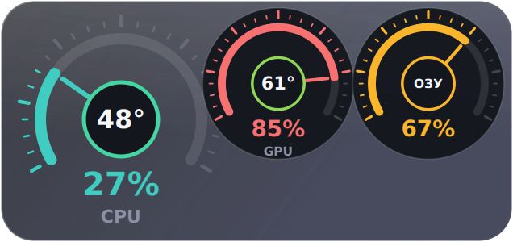
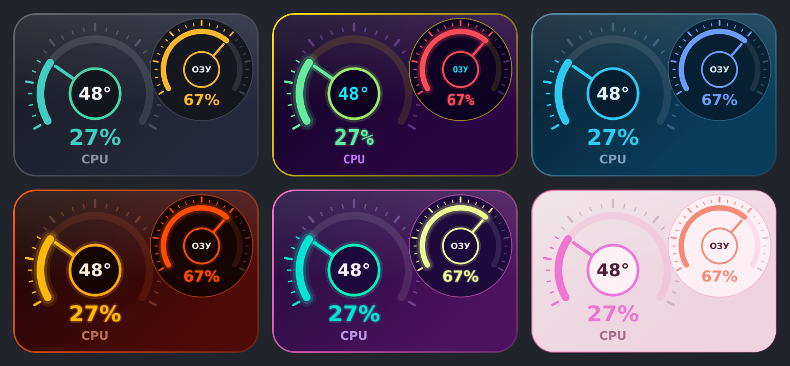
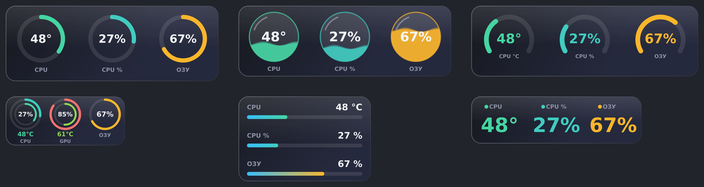
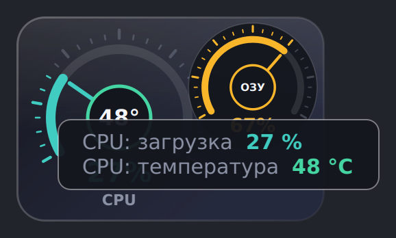

# TempGadget

[English](README.md) | **Русский**

Небольшой виджет рабочего стола для Windows, который поверх окон показывает температуру и загрузку CPU, GPU, оперативной памяти и дисков в реальном времени. Оформление в духе классических датчиков 8GadgetPack: стрелка спидометра показывает загрузку, а в центре температура.



## Возможности

- **Показания:** температура и загрузка CPU, температура и загрузка GPU, занятая память, температура каждого диска с датчиком.
- **Спидометры как в 8GadgetPack:** первый крупный, остальные меньше и накладываются на его край. Стрелка это загрузка, в центре температура.
- **10 видов, 14 тем, 5 форм** и пресеты в один клик, всё комбинируется.
- **Размер 20-100%** (Ctrl + колесо мыши или меню), расположение **горизонтально / вертикально**.
- **Подсказка при наведении:** крупная надпись с названием и значением, читается даже при малом масштабе. Для ОЗУ ещё показано занято / всего в ГБ.
- **Язык интерфейса: русский / English**, переключается в меню по правому клику (по умолчанию как в Windows).
- Значок в трее с показаниями, прозрачность, «поверх всех окон», запоминание положения и настроек.
- Необязательная **очистка системы** (временные файлы, кэши, корзина и др.). Запускается только по вашему действию, пункты выбираются в диалоге.
- Нормальный **установщик** с лицензией, описанием, автозапуском и установкой драйвера.

## Скриншоты

Превью нарисованы на условных значениях.







## Установка

1. Скачайте `TempGadget_Setup.exe` на странице [Releases](../../releases).
2. Запустите и пройдите мастер установки. Галочки: ярлык на рабочем столе, автозапуск с Windows, драйвер PawnIO.
3. Запустите TempGadget. Установщик не подписан, поэтому SmartScreen может показать предупреждение: «Подробнее» → «Выполнить в любом случае».

**Требования:** Windows 10 или 11 (64-бит), права администратора (нужны для чтения датчиков). Для температуры процессора нужен драйвер [PawnIO](https://github.com/namazso/PawnIO.Setup), мастер установки может поставить его сам (нужен интернет).

## Управление

| Действие | Результат |
| --- | --- |
| Перетаскивание левой кнопкой | Переместить виджет |
| Правый клик | Меню: пресеты, что показывать, тема, вид, форма, ориентация, размер, прозрачность, язык, поверх окон, очистка, выход |
| Ctrl + колесо мыши | Размер (20-100%) |
| Двойной клик | Свернуть в трей |
| Наведение | Подсказка с названием и значением |

Настройки хранятся в `%APPDATA%\TempGadget\config.json`. Язык: правый клик → *Язык / Language*.

## Сборка из исходников

Нужны Windows 10/11, Python 3.9-3.13 (или скрипт предложит поставить через winget) и интернет при первой сборке.

```
build.bat
```

Скрипт создаёт кэшированное окружение, скачивает LibreHardwareMonitor, собирает `dist\TempGadget.exe` через PyInstaller, один раз скачивает Inno Setup и делает `dist\TempGadget_Setup.exe`. `build.bat /clean` очищает кэш. Версия и автор задаются в начале `build.bat` (`VER`, `AUTHOR`).

## Решение проблем

- **Температура CPU показывает `--`:** нет драйвера PawnIO. Установите `winget install namazso.PawnIO` и перезапустите виджет.
- **Предупреждение антивируса:** exe собран PyInstaller в один файл и просит права администратора, из-за этого срабатывают некоторые сканеры. Можно собрать самому из исходников.

## Сторонние компоненты

LibreHardwareMonitor (MPL 2.0), PySide6 / Qt for Python (LGPLv3), драйвер PawnIO (namazso), Inno Setup (только при сборке).

## Лицензия

Программа бесплатна. Условия в `installer/license.txt`.

## Автор

localcontrol
