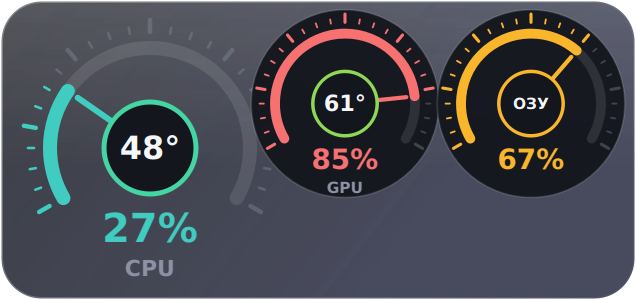
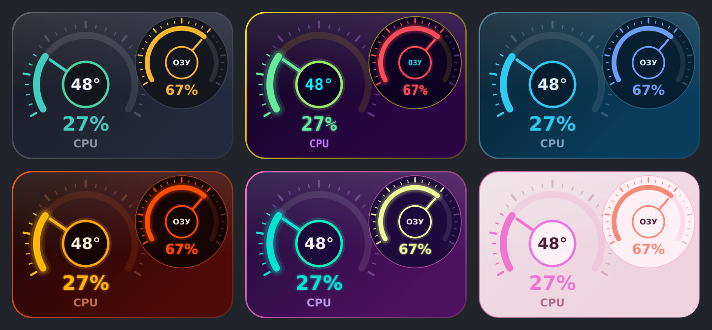
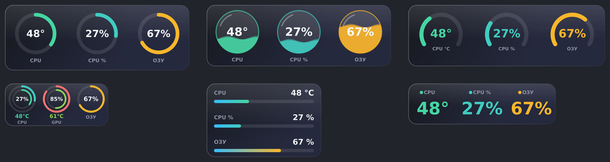
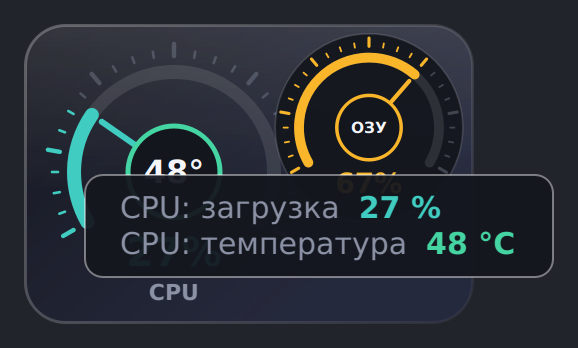

# TempGadget

A small always-on-top desktop gadget for Windows that shows the temperature and load of your CPU, GPU, RAM and drives in real time. Styled after the classic 8GadgetPack meters: a speedometer whose needle shows the load, with the temperature in the hub.



## Features

- **Readings:** CPU temperature and load, GPU temperature and load, RAM usage, temperature of every drive that has a sensor.
- **Speedometer layout in 8GadgetPack style:** the first dial is large, the others are smaller and overlap its edge. Needle = load, centre = temperature.
- **10 layouts, 14 themes, 5 shapes** and one-click presets. Combine them freely.
- **Size 20-100%** (Ctrl + mouse wheel or the menu) and **horizontal / vertical** arrangement.
- **Hover hint:** point at any dial to get a large, readable label with the name and value, even at small scale. RAM also shows used / total GB.
- Tray icon with live readings, opacity, always-on-top, remembers position and settings.
- Optional **system cleaner** (temp files, update cache, browser caches, shader caches, thumbnails, crash dumps, recycle bin, DNS cache). It runs only when you ask for it and lets you choose what to clean.
- Proper **Windows installer** with license, description, autostart option and driver setup.

## Screenshots

Previews are rendered with sample values.







## Install

1. Download `TempGadget_Setup.exe` from the [Releases](../../releases) page.
2. Run it and follow the wizard. Optional checkboxes: desktop shortcut, start with Windows, install the PawnIO driver.
3. Start TempGadget. The installer is unsigned, so Windows SmartScreen may show a warning: click *More info*, then *Run anyway*.

**Requirements:** Windows 10 or 11 (64-bit) and administrator rights (needed to read hardware sensors). CPU temperature needs the [PawnIO](https://github.com/namazso/PawnIO.Setup) driver; the installer can set it up for you (internet connection required).

## Usage

| Action | Result |
| --- | --- |
| Drag with the left mouse button | Move the gadget |
| Right click | Menu: presets, what to show, theme, layout, shape, orientation, size, opacity, always-on-top, cleaner, exit |
| Ctrl + mouse wheel | Change size (20-100%) |
| Double click | Minimize to tray |
| Hover | Hint with the name and value |

Settings are stored in `%APPDATA%\TempGadget\config.json`. The interface language is currently Russian.

## Build from source

You need Windows 10/11, Python 3.9-3.13 (or let the script offer to install it via winget) and an internet connection for the first build.

```
build.bat
```

The script creates a cached virtual environment, downloads LibreHardwareMonitor, builds `dist\TempGadget.exe` with PyInstaller, downloads Inno Setup (once) and produces `dist\TempGadget_Setup.exe`. Use `build.bat /clean` to wipe the cache. Version and author are set at the top of `build.bat` (`VER`, `AUTHOR`).

Layout of the repository:

```
src/temp_gadget.py     the application
installer/             Inno Setup script, license and info pages
build.bat              build script
docs/                  screenshots
```

To run from source, install `pythonnet` and `PySide6`, put the LibreHardwareMonitor DLLs into `src\libs`, and start `python src\temp_gadget.py` from an administrator console.

## Troubleshooting

- **CPU temperature shows `--`:** the PawnIO driver is missing. Install it with `winget install namazso.PawnIO` and restart the gadget.
- **Antivirus warning:** the exe is a PyInstaller one-file build that requests administrator rights, which some scanners flag. Build it yourself from source if in doubt.

## Third-party components

- [LibreHardwareMonitor](https://github.com/LibreHardwareMonitor/LibreHardwareMonitor) (MPL 2.0) reads the sensors.
- [PySide6 / Qt for Python](https://doc.qt.io/qtforpython-6/) (LGPLv3) draws the interface.
- [PawnIO](https://github.com/namazso/PawnIO.Setup) by namazso is the driver used for CPU temperature.
- [Inno Setup](https://jrsoftware.org/isinfo.php) builds the installer (build time only).

## License

The program is free to use. See `installer/license.txt` for the terms.

## Author

Artvip
